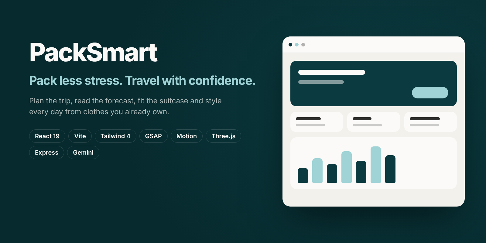
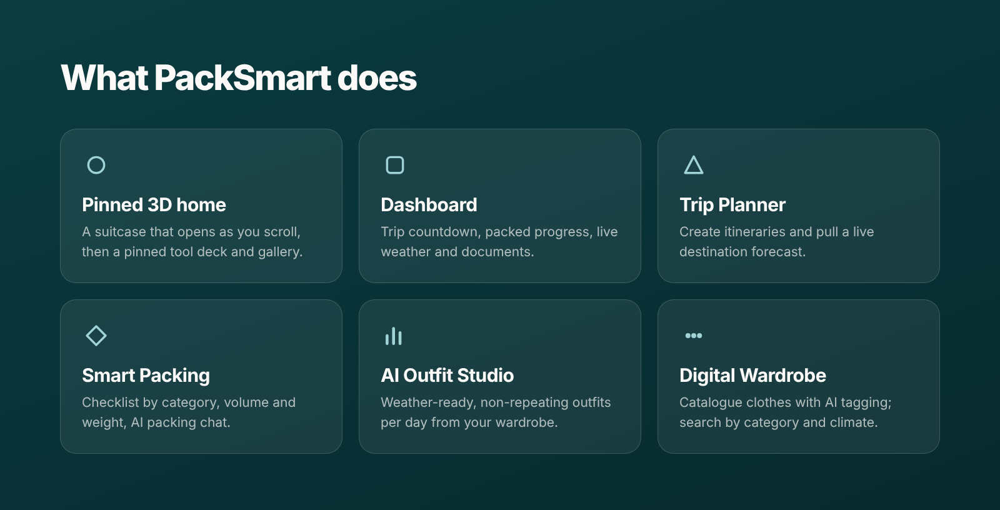
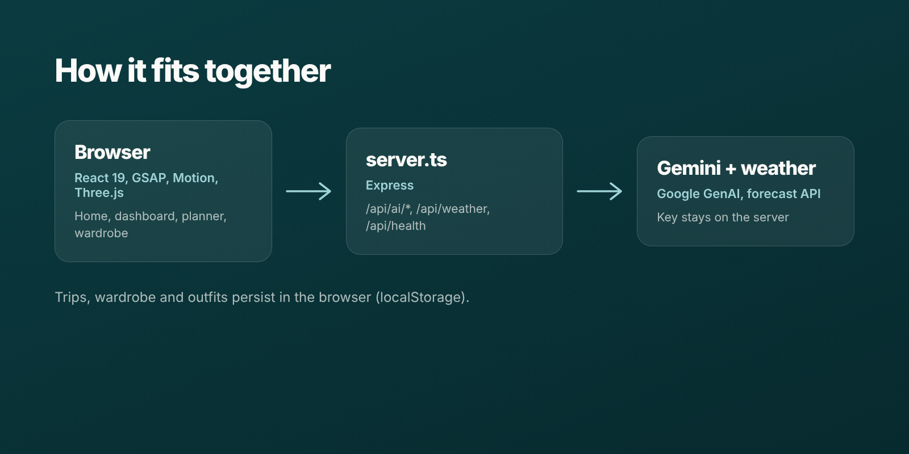

# PackSmart



A travel-packing workspace that plans the trip, reads the forecast, fits the suitcase and styles every day from clothes you already own.

**Stack:** React 19, Vite, Tailwind CSS 4, GSAP (ScrollTrigger), Motion (Framer Motion), Three.js, Express, Google Gemini.



## What it does

| Page | What you can do |
|---|---|
| Home | Pinned 3D hero with a suitcase that opens as you scroll, packing story, 3D tool deck, journeys gallery, departure board of your trips, capsule calculator |
| Dashboard | Active trip countdown, packed progress, live weather, documents |
| Trip Planner | Create itineraries, pull a live destination forecast, track the countdown |
| Smart Packing | Checklist by category, suitcase volume and weight, AI packing chat |
| AI Outfit Studio | Upload clothes, get weather-ready, non-repeating outfits per day, save favourites |
| Digital Wardrobe | Catalogue clothes with AI tagging from photos, search and filter by category and climate |

The original classic workspace (lists, essentials, history, profile, dark mode) is still available from the Vault & Tools menu.

## Interactions

- Home: drag or tap the 3D suitcase to turn it (with inertia) and open or close the lid; deck cards have a pointer spotlight and expand on click for details.
- Smart Packing: Pack Station, drag items into a suitcase (or tap / press Enter) with live litre and kilogram meters and an over-limit warning.
- Trip Planner: reorder the preparation timeline by dragging a handle or with the up/down buttons.
- All of it respects prefers-reduced-motion; touch drags start from the grip handle so the page still scrolls.

## Design

- Palette: deep midnight teal `#0B3B40`, soft pearl `#FBFAF8`, jet black `#0A0A0A`, with pale teal and warm pearl tints. Wardrobe sample colours are data and keep their real garment colours.
- Type: Plus Jakarta Sans, heavy and tight for headlines.
- Motion respects `prefers-reduced-motion`.

## Run it locally

```bash
npm install
cp .env.example .env     # add your GEMINI_API_KEY
npm run dev              # http://localhost:3000
```

Other scripts: `npm run build` (production bundle), `npm run preview`, `npm run lint` (type check).

## Environment variables

| Variable | Needed for |
|---|---|
| `GEMINI_API_KEY` | AI chat, clothing analysis, outfit matching. Server-side only; never sent to the browser. |
| `APP_URL` | Self-referential links when hosted |

Without a key the app still works; AI features show a "configure GEMINI_API_KEY" message.

## API (server.ts)

`GET /api/health`, `GET /api/weather`, `POST /api/ai/chat`, `POST /api/ai/enhance-list`, `POST /api/ai/analyze-clothing`, `POST /api/ai/match-outfits`.

## How it fits together



## Project layout

```
server.ts                Express server, Gemini proxy, weather proxy
src/App.tsx              State, routing, persistence
src/components/platform  Page views, home, shell, page banners
src/components/editorial Pinned scroll sections, 3D suitcase, motion helpers
src/components/spatial   Open-suitcase 3D
src/screens              Classic workspace screens
src/data                 Templates and sample data
src/utils                Packing engine, storage
```

## ✈️ Travel Tip of the Day

- Roll clothes instead of folding them to save luggage space.
- Keep essential documents easily accessible.
- Pack versatile outfits that can be mixed and matched.
- Always leave a little extra space for souvenirs.


The images in `docs/` are overview graphics, not screenshots. Replace them with real screenshots of the running app whenever you like (keep the same file names).
